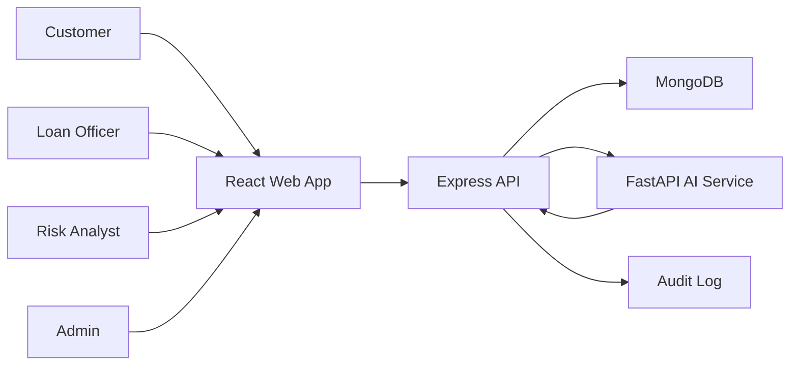
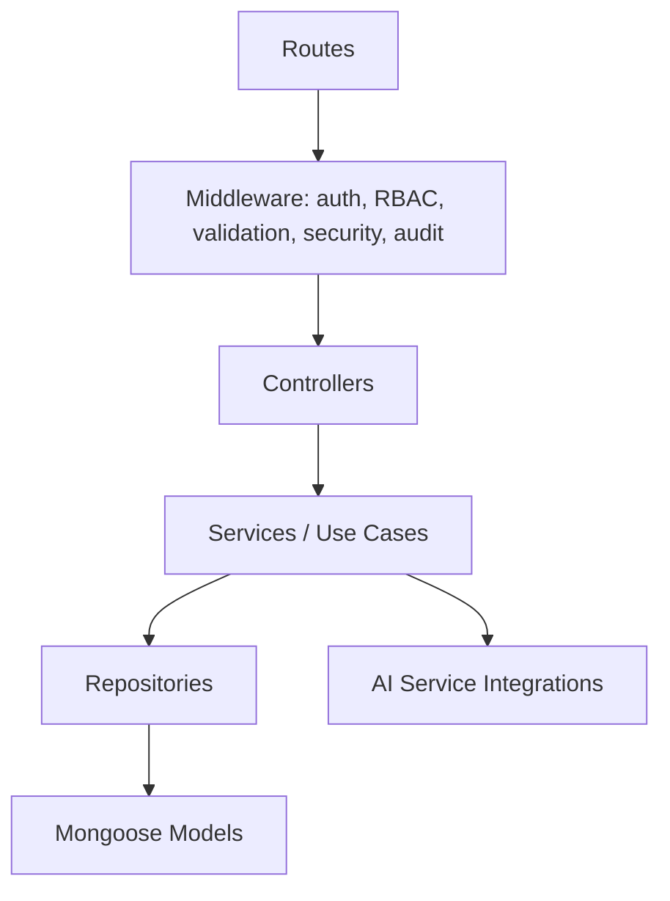

# Architecture

FinGuard AI uses a service-oriented monorepo. The API, web application, AI service, and shared contracts are separated so each can evolve, test, and deploy independently.

## System Context



## API Layering



## Design Decisions

- Monorepo with npm workspaces keeps frontend, backend, and shared TypeScript contracts aligned without coupling Python service dependencies to Node.js.
- The backend follows clean architecture boundaries: controllers handle HTTP, services own business rules, repositories own persistence, and middleware owns cross-cutting concerns.
- MongoDB is accessed through repositories rather than directly from controllers or services that do not need persistence details.
- The AI service is isolated behind HTTP integration clients so model dependencies, model lifecycle, and Python runtime concerns do not leak into the banking API.
- Shared enums live in `packages/shared` to prevent role, risk, status, and alert drift between API and frontend.

## Security Architecture

- Passwords are hashed before persistence.
- Refresh tokens are hashed at rest and rotated.
- JWT claims carry subject, role, token type, and expiry only.
- RBAC is centralized in middleware and enforced again inside sensitive service workflows.
- Audit logging records authentication, loan decisions, fraud decisions, administrative changes, and security-relevant failures.
- Input validation is mandatory at API boundaries.

## Phase 6.12: Human Review Workflow

Phase 6.12 implements a human-in-the-loop review system that transforms the credit risk model into an interactive lending platform.

### Data Models

**LoanReviewDecision** - Stores reviewer decisions for loans in UNDER_REVIEW status:

- Links loan application, risk assessment, and reviewer
- Captures AI recommendation (category, score, probability)
- Stores human decision (APPROVED, REJECTED, MORE_INFO_REQUIRED)
- Automatically detects overrides (e.g., HIGH risk → APPROVED)
- Indexes: (loanApplicationId, reviewedAt), (reviewerId, reviewedAt), (reviewerDecision, reviewedAt)

**ReviewFeedback** - Persists review data for future model retraining:

- Same structure as LoanReviewDecision but designed for ML pipeline consumption
- Includes features dictionary (loan characteristics at review time)
- Optionally stores final outcome after loan disbursement
- Enables supervised learning from human expertise

### Service Layer

**ReviewService**:

- `submitReview()` - Validates loan status, creates decision record, updates loan status, logs audit events
- `getReviewHistory()` - Retrieves all reviews for a loan in reverse chronological order
- `getReviewerReviews()` - Returns all decisions by a specific reviewer
- Status transitions: UNDER_REVIEW → (APPROVED | REJECTED | MORE_INFO_REQUIRED)

**ReviewAnalyticsService**:

- `calculateAnalytics()` - Overall metrics: approval rate, rejection rate, override rate, AI agreement rate
- `getReviewerStats()` - Per-reviewer performance: total reviews, decision distribution, override percentage
- Enables leadership dashboards and quality assurance workflows

### Repository Pattern

**LoanReviewDecisionRepository** & **ReviewFeedbackRepository**:

- Implement interfaces for testability (in-memory or Mongoose)
- Support complex queries (by loan, by reviewer, by decision type)
- Enable override detection at persistence layer
- Override logic: (HIGH risk + APPROVED) OR (LOW risk + REJECTED)

### API Endpoints

| Method | Path                                | Role                | Purpose                  |
| ------ | ----------------------------------- | ------------------- | ------------------------ |
| POST   | `/api/v1/reviews/:loanId`           | LOAN_OFFICER, ADMIN | Submit review decision   |
| GET    | `/api/v1/reviews/history/:loanId`   | Authenticated       | Review history for loan  |
| GET    | `/api/v1/reviews/my-reviews`        | LOAN_OFFICER, ADMIN | Reviewer's own decisions |
| GET    | `/api/v1/reviews/analytics`         | RISK_ANALYST, ADMIN | Overall platform metrics |
| GET    | `/api/v1/reviews/stats/:reviewerId` | ADMIN               | Reviewer performance     |

### Audit Trail

New audit events introduced in Phase 6.12:

- **LOAN_REVIEW_STARTED** - Manual trigger when review workflow begins
- **LOAN_REVIEW_COMPLETED** - Automatic when submitReview() succeeds, includes decision + override flag
- **AI_DECISION_OVERRIDDEN** - Fired when reviewer's decision conflicts with AI recommendation
- **REVIEW_FEEDBACK_RECORDED** - When feedback record created for future retraining

All events capture requestId, reviewer ID, IP address, and timestamp for compliance.

### Future Retraining Support

ReviewFeedback records stored in consistent format for supervised learning pipeline:

```
{
  "features": {...},           // Loan characteristics at review time
  "aiDecision": "HIGH",        // AI's categorization
  "humanDecision": "APPROVED", // Reviewer's decision
  "override": true,            // Whether reviewer disagreed with AI
  "finalOutcome": null         // Populated later: PAID_ON_TIME | DEFAULT | PREPAID
}
```

Phase 7+ can consume ReviewFeedback as training data to continuously improve the credit risk model based on actual outcomes and human expertise.

### Test Coverage

Unit tests cover:

- Review submission with valid/invalid decisions
- Override detection (HIGH+APPROVED, LOW+REJECTED, MEDIUM+any)
- Status transition validation
- Analytics calculations (approval/rejection/override rates)
- AI agreement scoring
- Audit logging

Integration tests cover:

- Full review workflow end-to-end
- Repository CRUD operations
- Analytics aggregation across multiple reviewers
- History retrieval in proper order

Target coverage: **90%+** (lines, branches, functions)

No MongoDB required for tests; all repositories use in-memory implementations or vitest mocks.

## Phase 6.13: Model Governance & Drift Monitoring

Phase 6.13 implements enterprise-grade AI governance, model lifecycle management, and drift monitoring to make the credit-risk platform resemble a regulated fintech AI system.

### Data Models

**ModelRegistry** - Tracks every model version through its lifecycle:

- Tracks version, type, training metadata, performance metrics (accuracy, precision, recall, F1, ROC-AUC)
- Dataset provenance: dataset name and size
- Lifecycle statuses: TRAINING → VALIDATION → APPROVED | REJECTED → RETIRED
- Approval workflow: stores approvedBy, approvedAt, approval flag
- Unique constraint on modelVersion

**ModelDriftRecord** - Captures feature-level drift between training and production:

- Stores training vs production means for each feature
- PSI-based drift score with severity classification
- Drift levels: LOW (< 0.1), MEDIUM (0.1-0.25), HIGH (0.25-0.5), CRITICAL (> 0.5)
- Time-series indexing for trend analysis

### Service Layer

**ModelGovernanceService**:

- `registerModel()` - Creates model in VALIDATION status, emits MODEL_SUBMITTED audit event
- `approveModel()` - Validates thresholds (accuracy, F1, ROC-AUC), transitions to APPROVED
- `rejectModel()` - Transitions to REJECTED
- `retireModel()` - Transitions to RETIRED
- Configurable approval thresholds with sensible defaults (0.75)
- Full audit trail for all lifecycle transitions

**DriftDetectionService**:

- Population Stability Index (PSI) calculation for distribution comparison
- Automatic drift level classification (LOW/MEDIUM/HIGH/CRITICAL)
- Histogram computation for arbitrary data distributions
- Batch feature analysis with single-call audit logging
- Configurable bin count for histogram precision

**GovernanceAnalyticsService**:

- Active/retired/approved/rejected model counts
- Average accuracy and F1 across production models
- Drift alert volume (last 30 days)
- CRITICAL drift alert count

### Repository Layer

**ModelRegistryRepository**:

- Full CRUD: create, findByVersion, findLatestApproved, listAll, findByStatus
- State transitions: approve, reject, retire
- Mongoose implementation with query chaining

**ModelDriftRepository**:

- Creation and query by model version
- Time-windowed counts for analytics
- CRITICAL drift filtering for alerting

### API Endpoints

| Method | Path                              | Roles               | Purpose            |
| ------ | --------------------------------- | ------------------- | ------------------ |
| POST   | `/api/v1/models`                  | ADMIN, RISK_ANALYST | Register new model |
| GET    | `/api/v1/models`                  | ADMIN, RISK_ANALYST | List all models    |
| GET    | `/api/v1/models/:version`         | ADMIN, RISK_ANALYST | Model details      |
| POST   | `/api/v1/models/:version/approve` | ADMIN               | Approve model      |
| POST   | `/api/v1/models/:version/reject`  | ADMIN               | Reject model       |
| POST   | `/api/v1/models/:version/retire`  | ADMIN               | Retire model       |
| POST   | `/api/v1/models/drift/check`      | ADMIN, RISK_ANALYST | Run drift analysis |
| GET    | `/api/v1/models/drift`            | ADMIN, RISK_ANALYST | List drift records |
| GET    | `/api/v1/models/analytics`        | ADMIN, RISK_ANALYST | Governance metrics |

### Drift Detection Algorithm (PSI)

The Population Stability Index measures how much a feature's distribution has shifted:

```
PSI = Σ (P_i - Q_i) × ln(P_i / Q_i)
```

Where:

- P_i = training proportion in bin i
- Q_i = production proportion in bin i
- Epsilon (1e-6) prevents division by zero

**Classification thresholds:**

- PSI <= 0.1: LOW (no significant shift)
- 0.1 < PSI <= 0.25: MEDIUM (minor shift, investigate)
- 0.25 < PSI <= 0.5: HIGH (significant shift, action required)
- PSI > 0.5: CRITICAL (severe shift, immediate attention)

Monitored features: age, annualIncome, loanAmount, debtToIncomeRatio, creditScore

### Audit Events

| Event                | When                                |
| -------------------- | ----------------------------------- |
| MODEL_SUBMITTED      | New model registered for validation |
| MODEL_APPROVED       | Model passes threshold checks       |
| MODEL_REJECTED       | Model fails validation              |
| MODEL_RETIRED        | Model decommissioned                |
| MODEL_DRIFT_DETECTED | Drift analysis completed            |

All events capture version, requestId, and timestamp for regulatory compliance.

### Governance Analytics Example

```json
{
  "activeModels": 2,
  "retiredModels": 1,
  "approvedModels": 4,
  "rejectedModels": 1,
  "averageAccuracy": 0.81,
  "averageF1": 0.87,
  "driftAlertsLast30Days": 5,
  "criticalDriftAlerts": 2
}
```

### Test Coverage

Phase 6.13 code:

- Service layer: 98-100% statement coverage
- Repository layer: 100% statement coverage
- Controller: 89.1% statement coverage
- Overall new code: 94.5% statement coverage

No MongoDB dependency in tests; all repositories use mocked Mongoose models.
