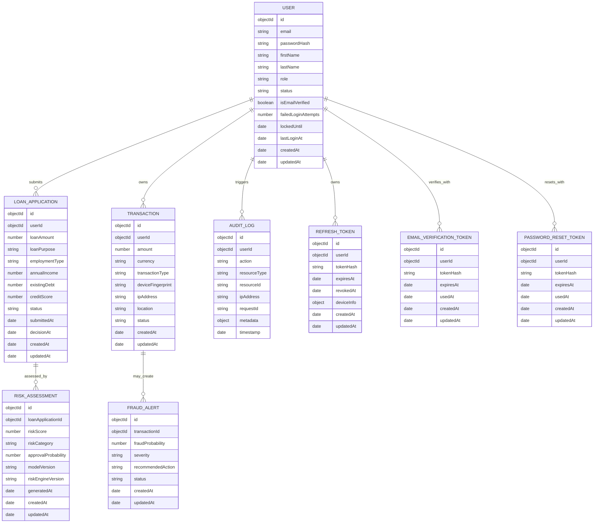

# Database ER Diagram

Phase 3 defines the MongoDB/Mongoose domain model foundation for FinGuard AI. Phase 4 adds authentication token persistence for refresh tokens, email verification, and password reset. Loan decision workflows, fraud workflows, and AI inference remain outside this phase.

## Collection Relationships

## Cardinality

| Relationship                      | Cardinality | Notes                                                                     |
| --------------------------------- | ----------- | ------------------------------------------------------------------------- |
| User to LoanApplication           | One-to-many | A customer may create multiple applications.                              |
| LoanApplication to RiskAssessment | One-to-many | Assessments are historical append-only records and are never overwritten. |
| User to Transaction               | One-to-many | Transactions are owned by a user/customer.                                |
| Transaction to FraudAlert         | One-to-many | A transaction may generate multiple investigation records over time.      |
| User to AuditLog                  | One-to-many | Audit records capture user-triggered changes and security events.         |
| User to RefreshToken              | One-to-many | Multiple active sessions are allowed and individually revocable.          |
| User to EmailVerificationToken    | One-to-many | Verification tokens are historical and marked used after consumption.     |
| User to PasswordResetToken        | One-to-many | Reset tokens are historical and marked used after consumption.            |

## Index Strategy

| Collection                  | Indexes                                                    | Purpose                                                                     |
| --------------------------- | ---------------------------------------------------------- | --------------------------------------------------------------------------- |
| `users`                     | unique `email`; `role,status`; `lockedUntil`               | Fast login/onboarding lookup, administrative filtering, and lockout review. |
| `loan_applications`         | `userId`; `status`; `userId,status`                        | Customer history, officer queues, and status dashboards.                    |
| `risk_assessments`          | `loanApplicationId,generatedAt`; `riskCategory`            | Latest assessment lookup and risk distribution analytics.                   |
| `transactions`              | `userId`; `createdAt`; `userId,createdAt`                  | Customer transaction timelines and fraud monitoring windows.                |
| `fraud_alerts`              | `transactionId`; `status`; `status,createdAt`              | Alert lookup, analyst queues, and aging reports.                            |
| `audit_logs`                | `timestamp`; `userId,timestamp`; `resourceType,resourceId` | Compliance trails, user activity review, and resource history.              |
| `refresh_tokens`            | unique `tokenHash`; `userId`; `expiresAt`; `revokedAt`     | Rotation lookup, session revocation, and expiry cleanup.                    |
| `email_verification_tokens` | unique `tokenHash`; `userId`; `expiresAt`; `usedAt`        | Verification lookup and token lifecycle cleanup.                            |
| `password_reset_tokens`     | unique `tokenHash`; `userId`; `expiresAt`; `usedAt`        | Reset lookup and token lifecycle cleanup.                                   |

## Validation and Constraints

- Schemas use strict mode with unknown fields rejected.
- Shared enums from `packages/shared` are the only enum source for backend schema validation.
- Monetary and probability fields use schema-level minimum and maximum constraints.
- Email is normalized to lowercase and uniquely indexed.
- Audit logs and risk assessments are immutable append-only records.
- Authentication tokens store hashes only; raw opaque tokens are returned once and never persisted.

## Future Scaling Considerations

- Audit logs and transactions are natural candidates for time-based archival or partitioning.
- High-volume fraud alert queues should use compound indexes that match analyst filters.
- Risk assessments intentionally allow multiple records per loan application for model version history.
- Document upload metadata will be added in a later phase and should reference `loan_applications`.
